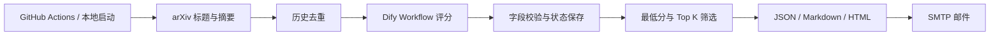
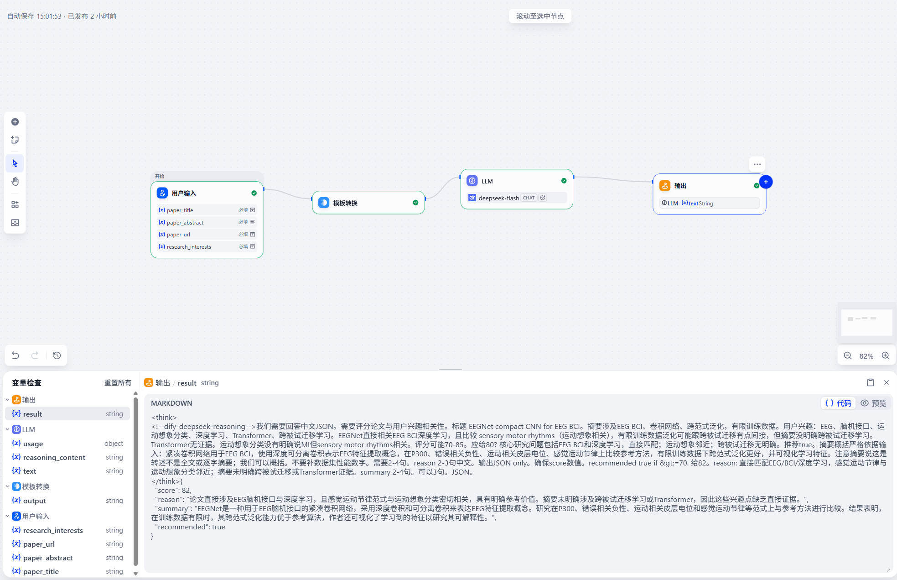

# Paper Tracker · 论文追踪与智能推荐

[](https://github.com/thinkercom/paper_tracker/actions/workflows/daily_paper_analysis.yml)
[](https://github.com/thinkercom/paper_tracker/releases)


用 **Python + Dify + GitHub Actions** 自动追踪 arXiv 论文，按研究兴趣评分，把筛选后的论文标题、原文链接、中文摘要与推荐理由发送到邮箱。

适合希望定期了解新论文、又不想每天逐篇翻阅 arXiv 的研究者。默认兴趣示例为 EEG、脑机接口、运动想象、深度学习与跨被试迁移学习，可替换成自己的方向。

## v1.0.0 能做什么

- **自动抓取**：按 arXiv 类别和时间窗口获取标题与摘要，候选数量可配置。
- **兴趣评分**：通过 Dify Workflow API 返回 0–100 相关性分数、中文摘要、推荐理由和阅读建议。
- **兼容 DeepSeek text**：支持 JSON 对象或字符串，也能处理完整的 `<think>...</think>` 前缀和 JSON 代码围栏；对评分字段严格校验。
- **筛选与去重**：按最低分、Top K 排序推荐，以去掉版本号的 arXiv ID 和研究兴趣/分析版本组合去重，失败论文可再次处理。
- **限流处理**：arXiv 查询缓存、串行访问、冷却记录和有限退避重试；Dify 对明确限流或连接建立超时有限重试。
- **多格式报告**：本地保存 JSON、Markdown 和 HTML；邮件包含纯文本与 HTML，没有新推荐时也说明统计结果。
- **每日自动运行**：GitHub Actions 计划在北京时间 08:00 启动，保存报告 artifact，并提交成功评分状态。

> 评分只依据标题与摘要，表示与研究兴趣的相关程度，不代表论文质量认证或全文审稿。模型调用可能产生费用。计划任务可能延迟，邮件会在任务处理完成后发送。

## 工作原理



Python 负责采集、去重、筛选、报告与邮件；Dify 负责模型分析；GitHub Actions 负责定时执行。初版不需要下载 PDF，也不需要让 Dify 负责抓取或发信。

### Dify 编排图



图中流程为 **用户输入 → 模板转换 → LLM → 输出**。模板转换用于组织四个输入字段；最简版本也可以直接在 LLM 提示词中插入变量。输出变量统一命名为 `result`，当前 DeepSeek 示例绑定 LLM 的 `text`。

完整提示词、JSON Schema 和配置步骤见 [Dify 搭建指南](docs/DIFY_SETUP.md)。仓库包含编排截图和接口示例，不包含可直接导入的 Dify DSL 文件。

## 快速开始

### 1. 安装

云端已使用 Python 3.12 验证。Windows PowerShell 示例：

```powershell
git clone https://github.com/thinkercom/paper_tracker.git
cd paper_tracker
python -m venv .venv
.\.venv\Scripts\python.exe -m pip install -r requirements.txt
Copy-Item .env.example .env
notepad .env
```

已有 `.env` 时直接编辑，不要再次复制覆盖。下面命令中的 `python` 请使用已安装依赖的解释器；若使用虚拟环境，可替换为 `.\.venv\Scripts\python.exe`。

### 2. 发布 Dify Workflow

创建 Workflow 应用，在开始节点设置四个必填文本变量：

| 变量 | 内容 |
|---|---|
| `paper_title` | 论文标题 |
| `paper_abstract` | 论文摘要，使用段落类型 |
| `paper_url` | 论文来源链接 |
| `research_interests` | 用户研究兴趣，使用段落类型 |

LLM 生成以下四字段 JSON，输出节点将完整对象或 JSON 文本映射到 `result`：

```json
{
  "score": 82,
  "reason": "与 EEG、脑机接口及深度学习密切相关；摘要未提供 Transformer 的证据。",
  "summary": "该论文介绍用于 EEG 脑机接口的紧凑卷积网络。",
  "recommended": true
}
```

以上为格式示例，不是固定评分。模型不支持结构化输出时可以使用 `text`，但最终答案仍须是完整 JSON。修改工作流后需要重新发布。

### 3. 填写本地 `.env`

```dotenv
DIFY_API_URL=https://api.dify.ai/v1
DIFY_API_KEY=填写Workflow应用APIKey
DIFY_USER=paper-tracker-local
RESEARCH_INTERESTS=EEG、脑机接口、运动想象分类、深度学习、Transformer、跨被试迁移学习
ARXIV_CATEGORIES=cs.LG,q-bio.NC
ARXIV_LOOKBACK_DAYS=5
MAX_PAPERS=3
MIN_SCORE=70
TOP_K=5
ANALYSIS_PROFILE=v1
```

自部署 Dify 使用应用 API 页显示的根地址，包含 `/v1`，不要附加 `/workflows/run`。这里填写的是 **Workflow 应用 Key**，底层模型供应商 Key 配置在 Dify 中。

### 4. 先验证接口，再运行抓取

```powershell
# 一篇真实论文示例：每次都调用 Dify，不经过历史去重。
python -m src.smoke_test

# 接入 analyze_paper()，基于本地示例生成报告。
python -m src.main --paper-file examples/test_paper.json

# 获取最近论文，先限制为一篇。
python -m src.main --max-papers 1

# 调整筛选规则。
python -m src.main --min-score 75 --top-k 5
```

示例使用 EEGNet 的标题、来源链接和根据真实摘要改写的测试文本，不是 PDF 全文。示例文件中的研究兴趣会优先于 `.env`；真实抓取使用 `.env` 的兴趣。

### 5. 配置邮件

QQ 邮箱示例，追加到 `.env`：

```dotenv
SMTP_SERVER=smtp.qq.com
SMTP_PORT=465
SMTP_SECURITY=ssl
SMTP_USERNAME=your_account@qq.com
SMTP_PASSWORD=填写SMTP授权码
EMAIL_FROM=your_account@qq.com
EMAIL_TO=receiver@example.com
```

`EMAIL_TO` 必须填写完整邮箱地址；多个收件人用英文逗号分隔。QQ 邮箱使用开启 SMTP 服务后生成的授权码，`EMAIL_FROM` 建议与登录邮箱一致。也支持 STARTTLS：`SMTP_SECURITY=starttls`，端口以邮箱服务商要求为准。

```powershell
# 完整流程并发邮件。
python -m src.main --max-papers 1 --send-email

# 只发送已有报告：不重新抓取，也不重复调用模型。
python -m src.mailer --report reports/papers-具体时间.json
```

未指定 `--send-email` 时，本地只保存报告。`Email sent.` 表示 SMTP 流程正常完成，是否进入收件箱仍需检查邮箱；发送失败不会自动反复投递。

## GitHub Actions：每天自动发论文日报

Fork 本仓库后，在 **Settings → Secrets and variables → Actions** 配置。`.env` 仅在本地使用，不会自动同步到 GitHub。

### Repository secrets

| 名称 | 用途 |
|---|---|
| `DIFY_API_KEY` | Workflow 应用 API Key，必填 |
| `DIFY_API_URL` | API 根地址；未填时使用 Dify Cloud |
| `SMTP_SERVER` | 邮件服务器，如 `smtp.qq.com` |
| `SMTP_PORT` | QQ SSL 示例为 `465`；工作流默认 `587` |
| `SMTP_USERNAME` | 完整登录邮箱 |
| `SMTP_PASSWORD` | 邮箱 SMTP 授权码 |
| `EMAIL_FROM` | 发件邮箱 |
| `EMAIL_TO` | 完整收件邮箱，多个用英文逗号分隔 |

### Repository variables

| 名称 | 默认值 / 示例 | 作用 |
|---|---|---|
| `ENABLE_SCHEDULE` | `true` 时开启 | 控制定时执行；首次建议先手动验证 |
| `SEND_EMAIL` | `false` | 设为 `true` 才发送云端邮件 |
| `SMTP_SECURITY` | `starttls` | QQ 465 端口应设为 `ssl` |
| `RESEARCH_INTERESTS` | EEG/BCI 示例 | 修改为自己的研究兴趣 |
| `ARXIV_CATEGORIES` | `cs.LG,q-bio.NC` | 英文逗号分隔 arXiv 类别 |
| `ARXIV_LOOKBACK_DAYS` | `5` | 查询最近天数 |
| `MAX_PAPERS` | `3` | 每次最多获取的候选数，1–100 |
| `MIN_SCORE` | `70` | 最低推荐分，0–100 |
| `TOP_K` | `5` | 每次最多推荐的篇数 |
| `ANALYSIS_PROFILE` | `v1` | 提示词/模型变化时可升级以重新评分 |

在 **Actions → Daily Paper Analysis → Run workflow** 手动运行一次。确认分析、邮件、状态提交和报告上传成功后，设置 `ENABLE_SCHEDULE=true`。

定时表达式为 `0 0 * * *`（UTC），对应北京时间每天 08:00。GitHub 计划任务可能延迟，且运行器需要能访问 Dify；本机 `localhost` 不能直接供 GitHub 托管 Runner 使用。

工作流显式申请 `contents: write`，只提交 `data/processed.json`；仓库设置及分支保护也须允许相应写入。报告和恢复状态保存为 artifact，默认保留 30 天。状态提交失败时应先检查权限，并从 artifact 恢复成功状态，避免下次重复评分。

## 数据、筛选与重试规则

- `reports/papers-时间.json` 保存本次所有成功评分、推荐列表、失败记录和统计；同名 `.md`、`.html` 展示推荐报告。
- `data/processed.json` 保存成功论文元数据、评分和研究兴趣。它会提交到仓库，公开仓库的访问者可查看这些内容；其中不保存 API Key、邮箱授权码或模型推理段。
- 无版本 arXiv ID、研究兴趣和 `ANALYSIS_PROFILE` 共同决定去重键。不同 arXiv 版本默认视为同一论文；改变兴趣或分析版本会重新评分。
- Python 根据 `score >= MIN_SCORE` 并按分数取 Top K；模型 `recommended` 只作参考。已成功评分但低于阈值的论文同样计入历史，修改阈值不会自动重推历史论文。
- 需要重新分析时使用 `--force`，会再次产生模型用量；同一批内部仍然去重。
- Dify 默认额外重试最多 2 次，仅针对明确的 429 和连接建立超时。读取超时、5xx、Workflow 失败或无效 JSON 不自动重发，避免远端已执行时重复消耗。
- arXiv 对相同查询默认缓存 15 分钟；同目录请求串行且至少间隔 3 秒。429 和可恢复服务错误有限重试，优先遵守 `Retry-After`；默认退避 30、60 秒，要求等待更长时保存冷却时间并退出。
- `.cache/arxiv/` 是本地缓存，不跨机器共享；不要在本地和云端同时频繁触发抓取。

可选本地配置：

```dotenv
DIFY_TIMEOUT_SECONDS=120
DIFY_MAX_RETRIES=2
ARXIV_MAX_RETRIES=2
ARXIV_CACHE_TTL_SECONDS=900
```

arXiv 限流时不会伪造抓取成功，也不会将旧报告静默当成当天结果。仅测试邮件请使用 `src.mailer`。

## 常见问题

| 现象 | 处理方式 |
|---|---|
| `Scored: 0; duplicates skipped: 1` | 正常去重；无需为测试邮件反复重新评分 |
| 没有推荐论文 | 可能全是历史论文，或没有达到评分阈值；检查 JSON 统计 |
| arXiv 返回 429 | 等待冷却，不要连续重启；缓存和退避不能保证立即解除服务端限流 |
| 缺少 SMTP 设置 | 编辑项目根目录 `.env`，不是 `.env.example` |
| 收件人被拒绝 | 检查 `EMAIL_TO` 是否包含 `@` 和域名，并核实邮箱地址 |
| Dify 输出无法解析 | 确认输出名为 `result`，JSON 完整，输出长度未截断；不要手动补齐不完整 JSON |
| 运行锁残留 | 确认旧进程已停止后，再移除对应 `run.lock` 或 `arxiv.lock` |
| 邮件失败但报告已生成 | 使用 `python -m src.mailer --report ...` 单独重发，不重复抓取或评分 |

## 项目结构

```text
paper_tracker/
├── .github/workflows/daily_paper_analysis.yml
├── .env.example              # 配置模板；真实配置放在被忽略的 .env
├── src/
│   ├── main.py               # 抓取、去重、筛选与报告入口
│   ├── arxiv_client.py       # 缓存、限流等待与抓取重试
│   ├── dify_client.py        # analyze_paper() 与输出校验
│   ├── state.py              # 去重记录、原子写入与运行锁
│   ├── reporting.py          # 筛选、Markdown 与 HTML 渲染
│   ├── mailer.py             # SMTP 发送与已有报告重发
│   └── smoke_test.py         # 单篇真实 API 验证
├── tests/                    # 22 项离线测试
├── examples/                 # 测试论文、结果 Schema 与配置交接模板
├── docs/DIFY_SETUP.md         # Dify 提示词和搭建步骤
├── imgs/Dify图片.jpg          # Dify 编排截图
├── data/processed.json       # 成功评分历史
└── reports/                  # 本地报告，Git 忽略
```

## 测试与版本

```powershell
python -m unittest discover -s tests -v
```

当前 22 项离线测试覆盖 API 输出解析、截断拒绝、去重、失败恢复、评分筛选、HTML 转义、邮件调用、arXiv 缓存和冷却重试。离线测试使用模拟网络响应，真实服务的连通性需要独立验证。

### v1.0.0 验收记录（2026-11-20）

[最新版云端完整运行](https://github.com/thinkercom/paper_tracker/actions/runs/44702107411) 已成功：22 项测试通过，5 篇历史论文被去重跳过，0 篇失败；SMTP 日志返回 `Email sent.`，报告 artifact 上传成功。

此前已验证真实 Dify API 评分、真实 arXiv 采集及本地报告。当前仓库定时和邮件开关均已开启。上述云端验收验证了邮件提交成功，不保证任何邮箱服务商的最终收件箱投递，也不保证之后每次都有满足阈值的新论文。

版本变化见 [CHANGELOG](CHANGELOG.md)。

## 致谢与资料

本项目参考了 [curryfromuestc/arxiv_paper_tracker](https://github.com/curryfromuestc/arxiv_paper_tracker) 的论文采集、定时报告与邮件推送思路，并围绕 Dify API、结构化校验与运行状态进行了实现。

- [Dify Workflow API](https://docs.dify.ai/en/api-reference/workflow-runs/run-workflow)
- [Dify LLM 节点与推理标签分离](https://docs.dify.ai/en/cloud/use-dify/nodes/llm)
- [arXiv API 与使用限制](https://info.arxiv.org/help/api/tou.html)
- [GitHub Actions 定时事件](https://docs.github.com/en/actions/reference/workflows-and-actions/events-that-trigger-workflows#schedule)
